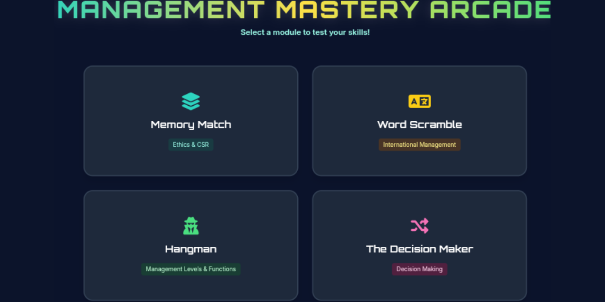

# Management Mastery Arcade

An interactive, web-based educational game created for the **Organization and Management Concepts** subject. This project features four engaging mini-games designed to test and reinforce the student's knowledge of key management principles.

## 🎮 Mini-Games Included:
1. **Memory Match:** Match management terms with their correct definitions (Ethics & CSR).
2. **Word Scramble:** Unscramble 40 key terms related to International Management.
3. **Hangman:** Guess the management functions and roles before the stickman is completed.
4. **The Decision Maker:** Drag and drop (or tap to move) terms into their correct categories (7 Steps of Decision Making vs. Individual vs. Group).

## 🛠️ Technologies Used:
- HTML5
- CSS3 (Tailwind CSS via CDN for layout)
- Vanilla JavaScript (Custom Game Logic)

## 🚀 How to Play:
The game is deployed and fully playable live on the web! No installation is required.

👉 **[Click here to play the Management Mastery Arcade](https://stephen-evangelista.github.io/Management-Mastery-Arcade/)**

*(Optional: To run locally, simply open `index.html` in any modern web browser.)*

## 👤 Author:
**Stephen Evangelista**
BSIS 2
